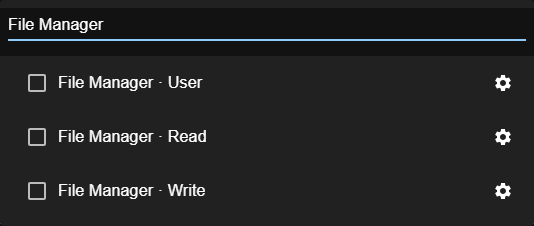

# 4. Security & permissions

Kwirth has three security layers:

1. **Administrator security** — the `admin` account and the `admin` scope (manage users, keys, IdPs).
2. **User security** — what each user may see and do, expressed as **scopes** on **resources**.
3. **API security** — keys for external tools and cross-cluster access (see [API management](05-api-management)).

This chapter explains the **permission model** you use when creating users.

## The model: resources = scopes + object filters

Every user carries a **list of resources**. Each **resource** is one permission entry made of two parts:

- **Scopes** — *what actions* are allowed (view, stream, operate, administer…).
- **Object filters** — *on which Kubernetes objects*: Namespaces, Deployments, ReplicaSets, ReplicationControllers, DaemonSets, StatefulSets, Pods and Containers.

A user is allowed to do something if **any** of their resources grants it. Within a resource, the scopes apply **only** to the objects that match the filters.

### Object filters

Each filter field takes a **comma-separated** list of names — **regular expressions are allowed** — and a **blank field means "all"**:

| Field value | Meaning |
|---|---|
| *(blank)* | all objects of that kind |
| `production` | every name **containing** `production` — including `production-jobs` and `pre-production` |
| `^production$` | that namespace **and no other** |
| `production,staging` | either of the two, with the same matching |
| `web-.*` | every object whose name matches the regex |

> 🔴 **They are regular expressions, and they are matched ANYWHERE in the name — not against the whole
> name.** This page used to say `production` meant *exactly that namespace*, and it does not: internally
> the check is `new RegExp(value).test(name)`, with no anchors. So granting `kwirth` also grants
> `kwirth-system`, and granting `dev` also grants `dev-datos`.
>
> It matters because it is the difference between what an administrator **thinks** they granted and what
> they granted. **Write `^name$` whenever you mean one object and not a family of them.** The security
> editor now says this above the fields.
>
> ⚠️ It is not being changed to match the whole name: every grant made until now relies on the current
> behaviour, and anchoring it would quietly take away access people are using. It is written down
> instead.

So a resource with **Namespaces = `^production$`** and everything else blank means *"these scopes, on all objects inside `production`"*.

## The scopes

When you edit a resource, **Scopes** is a **searchable selector** (filter box + checkbox per scope, with a tooltip describing each):

| Scope | Grants |
|---|---|
| `admin` | **Administrative access** — manage users, API keys and identity providers (unlocks the security menus). |
| `cluster` | **Full access** — effectively admin-level; can do everything. Some channels also require it to operate at the cluster level (e.g. mutating actions in Topology/Magnify). |
| `api` | Create **API keys** (the API Security features). |
| `view` | **View** data from a channel (logs). |
| `filter` | View data with **filtering** applied. |
| `stream` | Receive a **live stream** of data from instances. |
| `snapshot` | Read a **point-in-time snapshot** (no continuous streaming). |
| `create` | **Create** instances a channel supports (e.g. alerts). |
| `subscribe` | **Subscribe** to a channel's output (e.g. alerts). |
| `ops$get` | Ops: **read/inspect** resources. |
| `ops$restart` | Ops: **restart / delete** workloads. |
| `trivy$user` | Trivy: **open the channel** and read the reports (vulnerabilities, config audit, secrets) **of the namespaces the key grants**. `cluster` reads them all; `admin` also installs and removes the operator. |
| `magnify$user` | Magnify: **open it** and see the cluster's health (metrics and events). It does **not** list resources. |
| `magnify$read` | Magnify: also see the **workloads and configuration**, with their contents. **Not the infrastructure** (nodes, CRDs, cluster roles…), which needs `cluster`. Narrowable by kind (see [Narrowing a scope](#narrowing-a-scope)). |
| `magnify$write` | Magnify: also **change those** — apply, delete, evict, scale, restart. Draining or cordoning a **node** needs `cluster`. |
| `fileman$user` | Fileman: **open it and browse** a container's filesystem. Browsing is all it grants. |
| `fileman$read` | Fileman: everything above **plus** **open / download** files. |
| `fileman$write` | Fileman: everything read can do **plus** edit, upload, create, rename, move/copy, delete. |
| `none` | Placeholder — no capability. |

> **Plugins can add their own scopes.** The list above is the **core** catalog plus the Ops/Trivy channel scopes, but the Scopes selector is **populated at runtime** from every installed channel/plugin (`ops$…`, `trivy$…`, and any a plugin declares). So after installing a new channel you may see **extra scopes** appear here automatically. There is **no** `ops$xterm` / `ops$execute` scope — opening a shell or running a command in [Ops](../extensions/plugins/ops) is not behind its own scope in the current version.

> **The `admin` scope is powerful.** It grants the whole security surface (users, keys, IdPs). Give it only to real administrators. The built-in `admin` account already carries it (plus `cluster`).

## Narrowing a scope

Object filters (namespaces, pods, containers) limit **where** a scope applies. Some scopes can also be limited by **what they act on**, which only the channel knows how to describe — a path for File Manager, a kind of resource for a topology channel.

Every scope belonging to a channel (the ones with a `$`) has a **gear** on the right of the dropdown. Pressing it asks what to limit that permission to:

- If the channel **declares a form**, you fill in its fields.
- If it does not, you get **one free field**: a path, a regular expression or a comma-separated list — whatever that channel understands.
- **Leaving it blank grants the scope in full**, exactly as ticking it does. The dialog says so before you save.

What gets stored is a single token, and the selector shows it in words — `File Manager · Write → /tmp` — so the permission stays readable months later. You never type or see the encoded form.

Ticking the row and narrowing it are **the same permission**: narrowing replaces the plain scope, it does not sit beside it. To change a limit, press the gear again — the form comes back filled in. To remove the permission, untick the row.

> 🔴 **The wider form always wins.** Resources are combined with OR, so a key holding both `fileman$write` and a narrowed `fileman$write → /tmp` can write **everywhere**: the limit does nothing. This cannot happen through the editor any more, but it can in a key built by hand through the API, or in one granted before this existed — and the editor warns you when it sees both. The same applies to `cluster` and `admin`, which sit above every channel scope: a user holding either is not limited by anything you narrow here.

> ⚠️ **A limit only applies if the channel enforces it.** The format is Kwirth's; the meaning is the channel's. A channel that does not yet read these limits will treat the permission as not granted at all — it fails closed, so nothing is exposed, but the permission will appear to do nothing. Check the channel's own page.

## How to think about it (grant least privilege)

Start from *what the person needs to do*, pick the **matching scopes**, then **narrow the objects** with filters. Leaving filters blank grants the scopes cluster-wide — deliberate for admins, usually too broad for everyone else.

## Worked examples

**A) A full administrator**

- One resource: **Scopes** `admin`, `cluster` · all filters blank.

**B) A production log/metrics viewer**

- **Scopes** `view`, `stream` · **Namespaces** `production` · rest blank.
- Can watch logs and metrics in `production`; cannot operate anything or see other namespaces.

**C) An operator for one app**

- **Scopes** `ops$get`, `ops$restart` · **Namespaces** `payments` · **Deployments** `checkout` · rest blank.
- Can inspect and restart the `checkout` Deployment in `payments` — and nothing else. *(Opening a shell isn't a separate scope; anyone who can reach the Ops channel on these objects can use the terminal.)*

**D) A security auditor**

- **Scopes** `trivy$user`, `cluster` · filters blank.
- Reads the vulnerability, config-audit and secret reports of **every** namespace, and has no log/ops
  access. With `trivy$user` alone and namespaces in the filters, they would read only those.

**E) An external integration (API)**

- **Scopes** `api` (plus the streaming scopes the integration needs, e.g. `view`, `stream`) · filters narrowed to what it should reach.
- Pair this with an **API key** — see [API management](05-api-management).

## A note on IdP users

Scopes and resources define **authorization** — *what a user can do*. For **authentication** — *proving who they are* — a user can use a kwirth password or an external Identity Provider. The permission model above is identical either way; IdP only changes how they log in. See [IdP integration](07-idp-integration).

## How passwords are kept

Two things never happen: the browser never sends the password, and kwirth never stores it.

The browser hashes it with SHA-256 and sends that; kwirth stores a **bcrypt** hash of what it receives and compares the two. So the clear text exists only while the user is typing it, and a stolen copy of the users Secret gives an attacker neither the password nor anything they can replay.

!> **A password stored in the clear is refused at login.** kwirth used to accept one, compare it and re-hash it on the way through, so that installations written before hashing kept working. That path has been removed — a way to accept an unhashed stored password is a way to make storing one work. An installation still holding one cannot log in: delete its `kwirth-users` Secret and let kwirth seed the admin again. Everything that creates a user today writes a hash, including the Helm chart and the user editor above.

This is also why there is no "show me this user's password" anywhere: there is nothing to show. If somebody loses theirs, you set a new one.

Next: [API management →](05-api-management)
