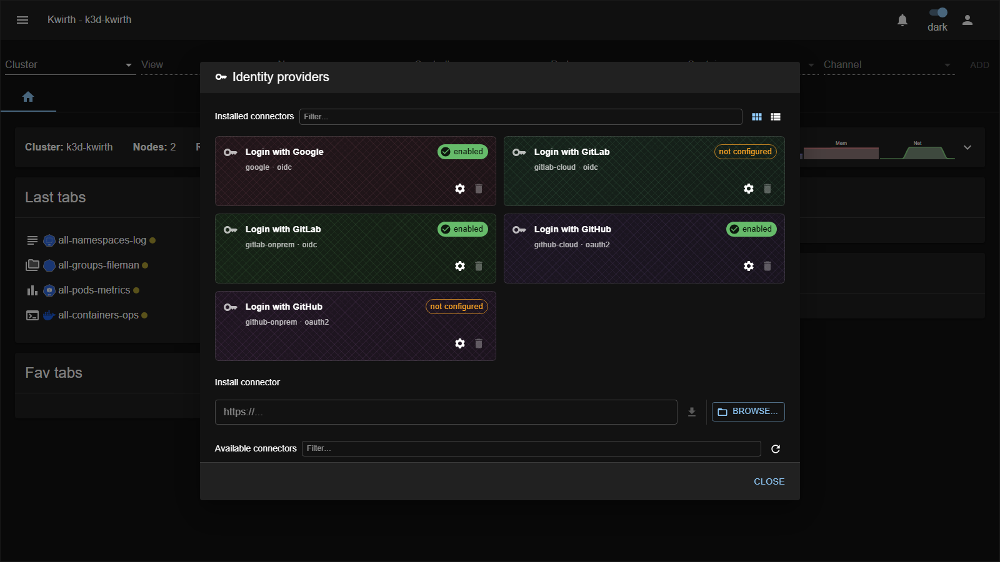
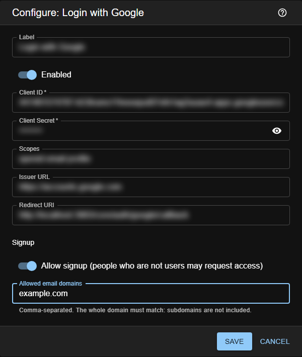
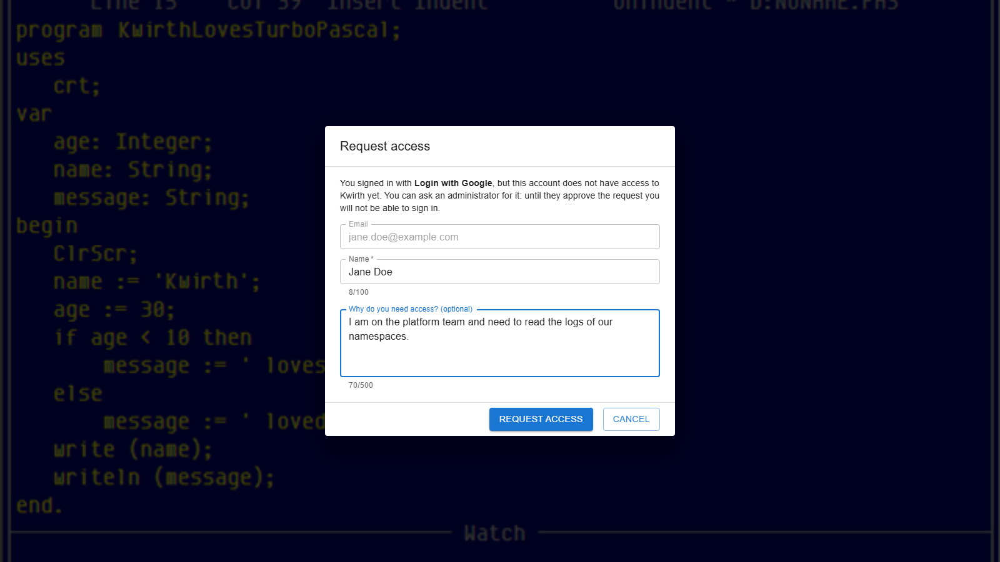

# 7. Identity Provider integration

Kwirth can delegate **authentication** to an external Identity Provider (IdP) so people sign in with their corporate or personal accounts (Single Sign-On) instead of a kwirth password.

## Authentication vs authorization

The key idea is the split:

- **Authentication** is done by the **IdP** — it only proves *"this really is `someone@example.com`, and we verified it"*.
- **Authorization** stays in **kwirth** — the person must already exist as a user and be bound to that IdP, and their [scopes/resources](04-security-and-permissions) decide what they can do.

The IdP says *who*; kwirth decides *whether* and *what*.

## How access is granted

For an IdP user to log in, **all** of these must hold:

1. The IdP reports the email as **verified**.
2. A kwirth **user exists whose Id is that email** (created in [User management](03-user-management)).
3. That user is **bound to the exact IdP** being used.

There is **no auto-provisioning** — signing in with Google (or any IdP) never creates an account by itself. What an IdP *can* allow, if you switch it on, is **signup**: someone who is not a user may **ask for access**, and an administrator approves or rejects the request (see [Signup](#signup-access-requests)). Until then, they are not a user and cannot get in. A verified email arriving from a *different* provider than the one assigned to the user is rejected. The built-in `admin` and any local user/password accounts keep working alongside SSO.

## Enabling an IdP

IdP connectors are **extensions** — no environment variables or restarts. Open **☰ → Manage extensions → Identity providers**:



- **Installed connectors** shows each connector with its state — **enabled** or **not configured** — plus a **Settings** (⚙) button and a delete button.
- **Available connectors** lists connectors you can install; **Install connector** takes a URL or **BROWSE…** for a local package. Toggle **Card / List view** with the buttons top-right.

Click a connector's **⚙ Settings** to configure it:



Typical fields:

| Field | Meaning |
|---|---|
| **Label** | Text shown on the login screen (e.g. *"Login with Google"*). |
| **Enabled** | Turns the connector on and makes its button appear on the login screen. |
| **Client ID / Client Secret** | The OAuth/OIDC credentials from the provider. Secrets are **write-only** and shown masked. |
| **Scopes** | The scopes requested from the provider. |
| **Issuer URL** | The provider's endpoint (needed especially for on-prem/self-managed connectors). |
| **Redirect URI** | The callback the provider must have registered. Pre-filled with the right value — see below. GitHub's connectors call it **Authorization callback URL**, which is what GitHub's own form calls it. |
| **Allow signup** | Lets people who sign in through this IdP **without being users** ask for access. Off by default. See [Signup](#signup-access-requests). |
| **Allowed email domains** | Only with signup on: the email domains that may ask, comma-separated (e.g. `example.com, example.org`). **Empty = anyone** with an account at this provider. |

The **Signup** fields are the same for every connector: they belong to Kwirth, not to the provider.

Configuration for all connectors is stored in a single Kubernetes secret (`kwirth-idps`), and secrets are never shown back in clear.

### The Redirect URI

This is the single most common first-run failure, and it fails with a message that points at the wrong
thing. **Copy the value from the connector's own field** and register it unchanged at the provider: it
has to match **byte for byte**, with no trailing slash.

Its shape is:

```
<scheme>://<host><ROOTPATH>/core/auth/<connector-id>/callback
```

Two parts of it are what go wrong, and neither is something kwirth can work out on its own:

- **`ROOTPATH`** — the subpath kwirth is served under. It is **`/kwirth` in the stock manifest and in
  the Helm chart**, so **most deployments need it**:
  `https://kwirth.example.com/kwirth/core/auth/google/callback`. It is empty only when kwirth sits at
  the root of its host, which is the case in a local dev box —
  `http://localhost:3883/core/auth/google/callback` — and that is why the development example is the
  exception, not the rule.
- **The scheme** — inside the pod the connection is **plain HTTP**. If your reverse proxy does not
  forward `X-Forwarded-Proto`, the value kwirth derives comes out as `http://…` for a site the browser
  reached over HTTPS, and the provider rejects it. OAuth2 only accepts `http` on loopback, so there is
  no deployment where guessing wrong is harmless.

Leave the field **empty** and kwirth derives the value from the request (guessing the scheme). **Fill it
in** and that exact string is what travels — in both the authorization request and the token exchange,
which OAuth2 requires to be identical.

> **If the provider says the redirect URI is invalid, check the `client_id` first.** The provider
> resolves the application by `client_id` and only then compares the callback against *that*
> application's registered URLs. A `client_id` left over from an older application fails with
> *invalid redirect uri* even when the URI is perfect.

## Supported connectors

Each provider is shipped as its **own connector** — cloud and on-prem variants are **separate** installable connectors:

| Connector | Protocol | Manual |
|---|---|---|
| **Google** (Google / Gmail) | OIDC | [Google](../extensions/idps/google) |
| **GitLab Cloud** (GitLab.com SaaS) | OIDC | [GitLab Cloud](../extensions/idps/gitlab-cloud) |
| **GitLab Self-Managed** (on-prem) | OIDC | [GitLab Self-Managed](../extensions/idps/gitlab-onprem) |
| **GitHub Cloud** (GitHub.com SaaS) | OAuth2 | [GitHub Cloud](../extensions/idps/github-cloud) |
| **GitHub Enterprise Server** (on-prem) | OAuth2 | [GitHub Enterprise Server](../extensions/idps/github-onprem) |

More connectors are packaged independently, so third parties can ship their own.

## Binding a user to the IdP

Enabling a connector is only half the job — each person still needs a kwirth user **bound** to it. That's done in [User management](03-user-management): create a user whose **Id is their verified email** and set the **IdP** field to the connector. See the section [IdP-bound users](03-user-management#idp-bound-users) there. Or, with signup on, let them ask and approve the request — next section.

## Signup (access requests)

With signup, you do not need to know in advance who will need Kwirth: the people themselves ask, and you decide. It is switched on **per IdP** with **Allow signup** in the connector's configuration (picture above), and it is **off by default** — with it off, everything works exactly as described in [How access is granted](#how-access-is-granted). There is **no signup for local users**: only people with an identity at a provider can ask.

### What the person sees

They click the IdP's button on the login screen and sign in at the provider as usual. If the provider verifies their email but they are not a Kwirth user, and the IdP allows signup for their domain, Kwirth offers to ask for access:



The **email** is the one the provider verified and cannot be edited; the **name** comes filled in from the provider and can be changed; the **reason** is optional and is what you will read when reviewing. After **REQUEST ACCESS** they are told the request was sent, and from then on, each time they sign in:

| State of their request | What they are told |
|---|---|
| **pending** | *"Your access request is pending. An administrator will review it."* |
| **rejected** | *"Your access request was rejected."* |
| **approved** | Nothing — they get in, with the permissions you gave them. |

If they close the dialog with **CANCEL**, nothing is sent: the next time they sign in they are offered it again.

### What you do

The requests appear in **☰ → User security**, under the users, and Kwirth tells administrators on login that some are waiting — and, if you choose a sender in [kwirth settings → Notifications](02-initial-config#notifications), each new request is also sent there as it arrives. Approving, rejecting and deleting them is explained in [User management → Access requests](03-user-management#access-requests-signup).

### Rules worth knowing

- **The domain must match whole.** `example.com` admits `jane@example.com` — and **not** `jane@mail.example.com` (a subdomain is a different domain) nor `jane@notexample.com`. Case does not matter. List each domain you want.
- **Leaving the domains empty on a public provider means anyone in the world.** With Google and no domain, any Gmail account can ask. They still cannot get in without your approval, but you will have to review whatever arrives.
- **At most 50 pending requests per IdP.** Beyond that, new people are told *"Access requests cannot be accepted right now"* until you approve, reject or delete some.
- **A request is not a user.** Requests are kept apart from the users (in their own Kubernetes secret, `kwirth-signups`), so a pending or rejected request can never be used to sign in — neither through the IdP nor with a password.
- **The email cannot be faked.** It is taken from what the provider verified, never from what the person types.
- **Switching signup off** stops new requests at once, including one being filled in at that very moment. Requests already made stay where they are, for you to approve or delete.

## Security

The SSO flow is protected with **PKCE + `state`**, a **back-channel** token exchange (the browser never sees provider tokens), a **single-use** login handoff, anti open-redirect checks, masked secret storage, and **admin-only** management. For the full details see the reference [IdP security notes](../../idp/security).

Next: [Extending kwirth →](08-extending-kwirth)
