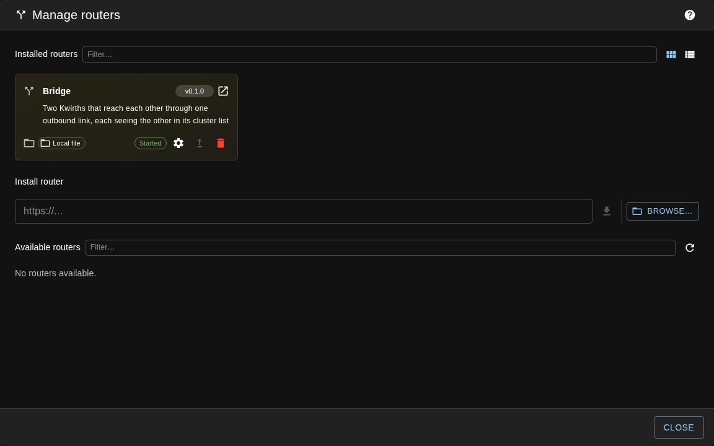
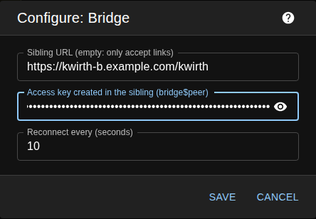
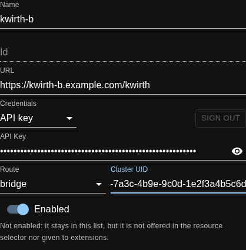

# Routers

A **router** carries Kwirth's traffic to a cluster that **cannot be reached directly**: a Kwirth behind NAT, a
firewall or a DMZ. It is a back-end extension: it has **no tab and no panel**. You install and configure it in the
**Routers** manager, and it writes what it does in Kwirth's log.

> **Rule of thumb.** A **plugin** draws something you open, a **provider** produces data, a **DCE** provides
> objects other extensions call. A **router** *carries traffic* to a cluster you cannot reach.

## How it works

```
  your browser / your Kwirth's back                your Kwirth                         the other cluster
  ─────────────────────────────────                ───────────                         ─────────────────
  cluster-list entry: its REAL url        ┌──────────────────────────────┐
  + route { router, cluster uid }         │ <root>/router/<id>/...       │   the router     ┌──────────┐
  ── requests and WebSockets ───────────► │  1. Kwirth authenticates it  │ ───────────────► │  Kwirth  │
                                          │  2. hands it to the router   │  (its own way)   └──────────┘
                                          └──────────────────────────────┘
```

1. An entry of your **cluster list** keeps the cluster's **real URL** — that is its identity, what you see and
   what is exported — plus a **route**: which router reaches it and the target cluster's **uid**.
2. Everything Kwirth does with that cluster — API calls, live channels, Magnify, the extra WebSockets some
   channels open — goes to `<root>/router/<id>/…` of **your own** Kwirth instead of the real URL.
3. Your Kwirth **authenticates** it before the router sees a byte, and tells the router who is calling. The router
   **decides** what that caller may do through it, and carries it however it is built to: a tunnel, a bastion, a
   proxy.

The real URL is never used for a routed entry, and a routed entry whose router is not installed **does not
connect at all** — it never falls back to the real URL, which is precisely the one that cannot be reached.

### Who may use a route

Your Kwirth lets traffic into a router in three ways, and nothing else gets in:

| How | Who uses it |
|---|---|
| A **route ticket** | Your browser. Kwirth gives your session a ticket and renews it on its own; it goes in the URL (a browser cannot put headers on a WebSocket) and Kwirth removes it before the router sees the path. It lasts 10 minutes and is not your credential: it only says which session is using the route. |
| **Loopback** | Your Kwirth's own back end, when a plugin connects to a routed cluster from the server. Accepted only from the same machine. |
| An **access key** of your Kwirth | Another Kwirth or a script, in the `Authorization` header. What a key may do through a router is the router's decision, usually by a scope it declares. |

Deleting an access key cuts at once the router connections made with it, and the route tickets it was given.

## Managing routers

*Menu → Manage extensions → Routers* opens the **Routers** manager: the same manager as every other extension
type, with *Installed routers* and *Available routers* (from your marketplaces), and *Upload* for a `.tgz`.



- **Installing, updating and uninstalling a router needs no restart.** It is up the moment it is installed.
- Each card says how the router is **right now**: **Started** (hover it to see what it is doing, e.g. who it is
  linked to), **Error** (it runs, but its last attempt failed — the tooltip says why) or **Failed** (it could not
  start; the tooltip says why).
- The **gear** opens its configuration.

### Configuring a router

A router's configuration is Kwirth's own dialog, drawn from the fields the router declares. Secret fields
(passwords, keys, tokens) are **shown masked**, with an **eye** to reveal them, and they are kept in a
Kubernetes **Secret**. Saving **applies at once**: the router takes the new values without restarting.



### Scopes a router declares

A router may declare its own scopes, and they appear in the security editor (*Users* and *Access keys*) next to
everybody else's. For example, the **Bridge** router declares `bridge$peer`: the key another Kwirth presents to
link to this one.

## Adding a routed cluster

*Menu → Manage cluster list → NEW*, and fill the entry as for any cluster — its **real URL** and an **API key of
that cluster** — plus:

| Field | What |
|---|---|
| **Route** | *Direct* (the default) or one of the routers installed in your Kwirth |
| **Cluster UID** | The target cluster's uid. It cannot be discovered without the route, so it is typed in: it is the **Id** that cluster shows for itself in its own *Manage cluster list* |



Both fields are always there; *Route* is disabled while there is no router installed, and *Cluster UID* while
the route is *Direct*. *Test* tries the entry **through its route**.

The API key is **the target cluster's**, as for any cluster: the router carries it untouched, and **that
cluster** authenticates and authorizes you with it. A router never gives you more than the target cluster would.

If a routed entry's router is uninstalled, the entry stays — *Route* shows the router as *(not installed)* — and
it simply does not connect until the router is back or you change the route.

## The log

Everything a router does goes to Kwirth's log under the component **Routers** (`rout`), with the router's id:
started, stopped, configuration applied, links, refusals, failures. *Settings → Log* lets you raise or lower its
level like any other component.

## Routers available

| Router | What it does |
|---|---|
| **[Bridge](bridge)** | Two Kwirths that reach each other through one outbound link, each seeing the other in its cluster list. Open source (`@jfvilas/kwirth-router-bridge`). |

## Writing a router

A router is a small back-end package. Kwirth includes a scaffolder that generates a working one — an **echo
router** that shows every part of the contract — ready to be built and installed:

```
node tools/create-kwirth-router.mjs --id my-router --publisher @my-scope
cd routers/my-router && npm install && npm run build
cd dist && npm pack        # install the .tgz from the Routers manager
```

The contract is `IRouter`, in `@kwirthmagnify/kwirth-common-back`:

| Member | What for |
|---|---|
| `getRouterData()` | Its id, its path template (`'/{routeTicket}/{clusterUid}'`) and whether it needs a route ticket |
| `routerRequest(req, res, caller)` | An HTTP request below `/router/<id>`, already authenticated; `req.url` without the ticket |
| `routerWebsocket(ws, req, caller)` | A WebSocket below `/router/<id>`, already authenticated |
| `getConfigSchema()` | The fields of its configuration dialog (`password` ones go to the Secret) |
| `getScopeCatalog()` | The scopes it declares, for the security editor |
| `startRouter` / `applyConfig` / `stopRouter` | Its lifecycle: started with its saved configuration, the configuration applied hot, stopped on uninstall or update |
| `getStatus()` | What its card says |

`caller.via` says how Kwirth let the traffic in (`ticket`, `loopback` or `accesskey`), and `caller.accessKey` is
the validated key when there is one. To develop against a running Kwirth, add the router's `dist` to
`back/kwirth-dev.json` under `"routers"`: Kwirth reloads it on every build. **[Bridge](bridge)**'s source is the
reference for a complete one.

A plugin can be a router too — a channel with a panel of its own that also carries traffic: it implements both
contracts, and is installed as a plugin.
