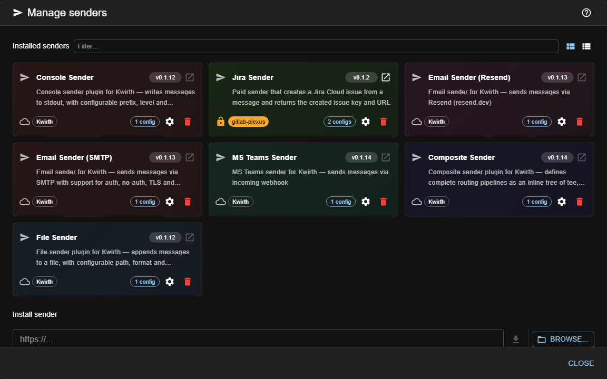
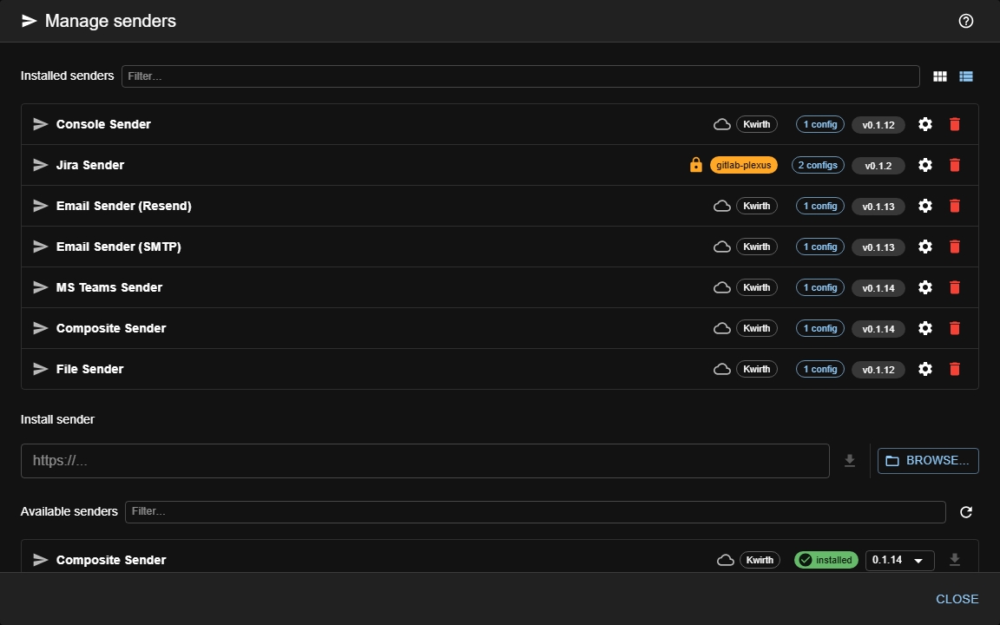
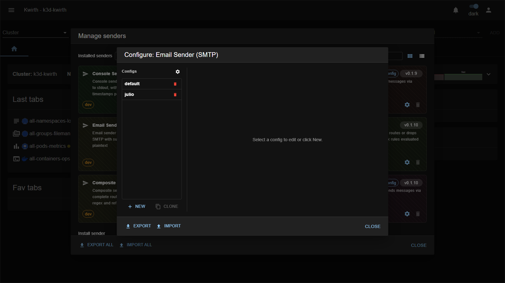

# Senders (output destinations)

> **Type:** Senders<br>
> **Managed from:** ☰ → Manage extensions → Senders

## What a sender is

A **sender** is an **output adapter**. When a channel or provider needs to push something out of kwirth — an alert email, a Teams message, a line to a log file — it hands the message to a sender, which knows how to deliver it to that specific destination. Senders are **fire-and-forget**: they send, they don't receive.

The key ideas:

- Each sender has an **id** (`console`, `email-smtp`, …) and holds one or more **named configurations**. For example, one `email-smtp` sender can carry a `default` config and a `oncall` config pointing at different mailboxes.
- Channels reference a sender by **`senderId` + config name** (you'll see a **"Sender config"** picker in channels like **[Alert](../plugins/alert)**, **[Censor](../plugins/censor)** and **[Echo](../plugins/echo)**).
- Some senders don't deliver anywhere themselves — they **wrap other senders** to add behaviour (fan-out, rate-limiting, batching, filtering). That's the **pipeline** pattern.

## Delivery senders

These deliver a message to a real destination:

| Sender | Delivers to | Key config |
|---|---|---|
| **[console](console)** | The kwirth server's **stdout/stderr**. | *(none — great for testing)* |
| **[file](file)** | A **rotating log file** on the server. | File path, rotation. |
| **[email-smtp](email-smtp)** | **Email** via an SMTP server. | Host, port, encryption, user, password, from, to. |
| **[email-resend](email-resend)** | **Email** via the **Resend** API. | API key, from, to. |
| **[teams](teams)** | A **Microsoft Teams** channel. | Incoming webhook URL. |

## Delivering in batches

A sender normally receives **one message per call**: kwirth awaits each delivery, and that is what makes
the promise meaningful — *this alert reached its destination*. For an alert that is exactly right.

For a **stream of log lines** it is not: one round trip per line turns forwarding into a queue, and the
destinations that take log volume (Datadog, Elastic, Loki) accept arrays and charge per request. So a
sender may also declare that it knows how to take a **batch**, and then kwirth hands it the whole lot in
a single call and awaits **once per batch** — the promise still means "these N lines delivered".

It is **optional on purpose**. A sender that does not declare it keeps receiving messages one at a time,
in order, and needs no changes: kwirth delivers them itself, and a line that fails does not cancel the
ones behind it.

Messages also carry **where they came from** — cluster, namespace, pod, container, and which provider or
channel they entered through. That travels **with the message**, because a destination can only tag what
arrives tagged: a log line that reaches Datadog without its namespace cannot be filtered by anything, and
is effectively useless. It is a field of its own rather than free-form metadata, so every sender finds it
in the same place.

## Pipeline senders

These don't deliver on their own — they **compose or shape** the flow, then pass it to other senders:

| Sender | What it does | Key config |
|---|---|---|
| **[tee](tee)** | Fans an incoming message out to **multiple downstream senders** simultaneously. | List of target `sender::config`. |
| **[regex](regex)** | **Routes or drops** messages by **ordered regex rules** evaluated against any message field. | Ordered rules + downstream targets. |
| **[timed](timed)** | **Routes or drops** messages by **time-of-day windows** and **day-of-week** rules. | Time windows / days + downstream. |
| **[ratelimit](ratelimit)** | **Throttles** delivery to a maximum rate to avoid flooding a destination. | Interval + downstream sender. |
| **[composite](composite)** | Defines a **complete routing pipeline** as an inline tree of **tee / regex / ref** nodes in a single config. | Pipeline tree (JSON). |

*(Each sender's exhaustive field list lives in the reference [Sender reference](/0.6.31/senders/reference/index).)*

## Managing & configuring senders

Open **☰ → Manage extensions → Senders**. Each sender is a **card** showing its description, how many **configs** it holds, and a **⚙️ gear** / **🗑️ delete**:



The **Card / List** toggle switches to one row per extension — the same information, easier to scan once you have a few installed. Both views tell you **where each extension comes from**: the icon and chip on every row name the marketplace serving it, which matters because a private marketplace can publish its own extension under an id that also exists in the public one.




1. Click a sender's **gear** to open its config manager. Each sender keeps a **list of named configs** — pick one to edit, **New** to add, **Clone** to copy:



2. Kwirth renders the config form from the **sender's own field schema**, so every field is typed (text / number / password / select) — no guesswork.
3. Once saved, that `senderId::configName` pair is selectable anywhere a channel offers a **Sender config** picker.

You can keep **many configs per sender** (above, `email-smtp` has `default` and `julio`) and reference whichever one you need per channel.

### Moving them to another kwirth

Through **☰ → Kwirth export**, the same door every extension uses. Each sender is its own entry in the file, so you can take some and leave others, and what travels is the whole set: the named configurations **and** the base fields they share (the SMTP server, the default *from*).

Two things worth knowing before you do it:

- **The passwords travel empty** unless you tick *Include credentials* — empty, not missing, so the destination can see which ones it has to fill in. Kwirth knows which fields are secret because each sender declares it in its own field schema.
- 🔴 **Importing replaces the list.** What you end up with is exactly what the file carried: configurations the destination had and the file does not mention **are removed**. It is the same rule for every extension in the bundle, and it is what makes two kwirths actually end up alike.

> The config manager used to have its own **Export / Import** buttons. They are gone. They wrote the configurations out **as they were**, so the passwords ended up in clear text in a file in somebody's downloads folder, and they merged on the way in while the bundle replaces — the same file left the system in two different states depending on which button you pressed.

## Using senders from a channel

Channels that can emit output expose a **Sender config** selector in their setup/config:

- **[Alert](../plugins/alert)** — deliver an alert when a log line matches.
- **[Censor](../plugins/censor)** — route censored/flagged output onward.
- **[Echo](../plugins/echo)** — the easiest way to **test** a sender end-to-end: start Echo with a sender selected and watch the destination receive its heartbeat.

## Admin guide

- **Install / enable / remove:** from **☰ → Manage extensions → Senders**, using the common flow in [Extending kwirth](../../admin/08-extending-kwirth).
- **Secrets:** SMTP passwords, Resend API keys and Teams webhook URLs are stored as sender config — treat them as credentials.
- **Testing:** use the **console** sender (no config) or **Echo + a sender** to validate delivery before wiring it into alerts.

## Writing your own

Scaffold one from the repo root:

```
node tools/create-kwirth-sender.mjs --id my-sender --name "My Sender" --publisher '@my-scope'
```

With no options it asks everything. With `--id`, `--publisher` is **required**: it decides the package name
(`@my-scope/kwirth-sender-my-sender`) and which registry the sender ends up in, so it is never guessed.

> ⚠️ **In PowerShell, quote it**: `--publisher '@my-scope'`. An argument starting with `@` is treated as
> splatting and is **silently dropped**.

What comes out is complete from the first minute: it **builds with a typecheck**, its **tests pass**, and it
carries a README ready for npm. What depends on the destination goes by flag:

| Flag | What you get |
|---|---|
| `--kind filter` | A **pipeline** node, like [regex](regex): it does not deliver, it decides whether the message goes on. |
| `--batch` | **Delivering in batches** (see above), with the mapping kept apart from the network: each message becomes the destination's event carrying its origin as fields — leaving out what is not known — lines written in the same millisecond keep their order, and the batch is split by the destination's limits (entries **and** bytes) **before** it goes out. |
| `--http` | The transport to an HTTP API: an *Endpoint* and a *Token* field, a timeout, and errors that say what to check (`answered 401 (missing or wrong token)`). And a **local double** of the API, used by the tests and served by `npm run double`, because no test should deliver to anyone's real destination. |
| `--private` | Nothing changes in the code: it only lists, at the end, what to do by hand to keep the sender out of public repositories. |

A log destination is typically `--batch --http`. Then:

```
cd senders/my-sender
npm install
npm test               # passes as generated
npm run build          # typecheck, bundle, dist/package.json and the README
```

While developing, point kwirth at your build like any other extension, and **restart the back** after a
change — the core loads `back.js` once:

```json
"senders": { "my-sender": "../senders/my-sender/dist" }
```

⚠️ With `--batch`, the limits in `src/back/map.ts` are **placeholders**: take the real ones from the
destination's documentation before writing the transport, not from memory. Finding them out through a
`413` means the request has already been paid for.

## Notes

- Senders are **backend-only** — there's no per-sender channel tab; you configure them centrally and reference them from channels/providers.
- Combine pipeline senders for real workflows: e.g. **ratelimit → composite → (email-smtp + teams)** to notify two places at a capped rate.

---

← Back to [Extension manuals](../index)
